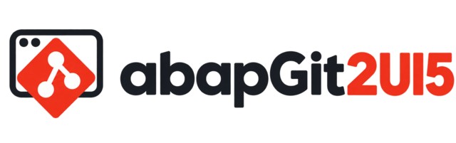
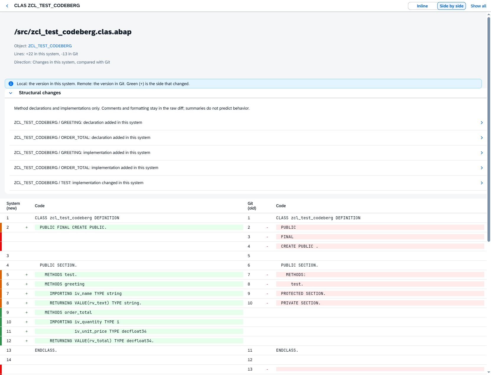
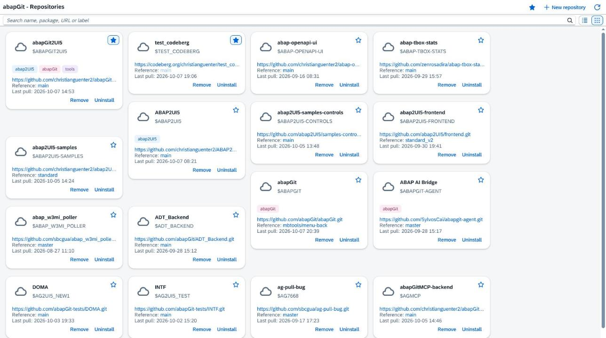
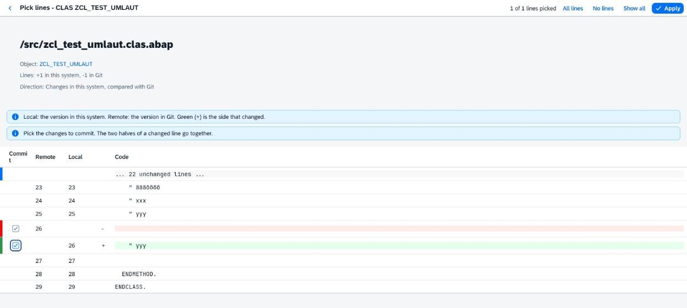
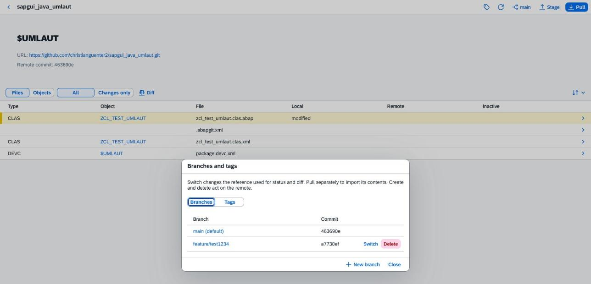

> [!WARNING]
> **EXPERIMENTAL.** This is a playground, not a product. Expect breaking
> changes, rough edges and bugs, and do not use it on production systems.
> Tested end to end on one SAP NetWeaver 7.5x system (A4H) only; other
> releases are untested.

<p align="center">
  <picture>
    <source media="(prefers-color-scheme: dark)" srcset="docs/logos/abapgit2ui5-dark.svg">
    
  </picture>
</p>

# abapGit2UI5

A browser frontend for [abapGit](https://github.com/abapGit/abapGit), built with
[abap2UI5](https://github.com/abap2UI5/abap2UI5). It uses the same abapGit
repositories and serialization, but runs in any browser instead of the SAP GUI
HTML control.



See the [short walkthrough](docs/walkthrough.md): open a repository, find
changes, review the diff, and choose what to commit.

## Highlights

Beyond what the conventional abapGit UI offers:

- 🌐 **Runs in any browser**, no SAP GUI HTML control; Status and diff pages have
  URLs that survive a refresh and can be bookmarked.
- 🛡️ **One pull dialog** instead of a sequence of popups: every change grouped by
  risk, abapGit's defaults preselected, and checked again before importing.
- 🔍 **Structural method review:** the diff summarizes added, removed and
  changed methods, each linked to its source range.
- 🔁 **Several commits in a row:** after a push, Stage stays open with the
  remaining changes, so partial changes (including picked lines) can be
  committed one after another without starting over from the repository.
- 🙈 **Ignore rules with a preview:** edit a pattern and see which files it
  affects before saving or removing it.
- 🗑️ **Uninstall with a preview:** the objects to be deleted are listed, and the
  package name must be typed to confirm.

## Screenshots

| Repositories | Status | Diff | Pull |
|---|---|---|---|
|  |  |  |  |

| Stage | Pick lines | Branches and tags |
|---|---|---|
|  |  |  |

## Getting started

**Prerequisites**

- The latest abapGit **developer version** (the `ZCL_ABAPGIT_*` classes). The
  standalone program is not enough, because its classes are local.
- abap2UI5 1.146.0 or later.
- ABAP 7.50 or later, and abapGit's startup authorization
  (`ZCL_ABAPGIT_AUTH_EXIT`).

**Installation:** install this repository with abapGit into a local package,
for example `$ABAPGIT2UI5`. It brings the ICF node `/sap/bc/zabapgit2ui5`
(activate it in SICF if needed) and the transaction `ZABAPGIT2UI5`.

**Start:** run transaction **ZABAPGIT2UI5**, or open

```
https://<host>:<port>/sap/bc/zabapgit2ui5?sap-client=<client>&app_start=zcl_ag2ui5_app_repos
```

If the server's own host name is not reachable from the browser (for example
in a container), maintain the browser's host, port and protocol for
`/sap/bc/zabapgit2ui5` in table `HTTPURLLOC`.

## Features

- **Repositories:** searchable list or tiles, favorites shared with abapGit,
  colored labels (click one to filter, edit them in the repository header).
- **New repository:** online or offline, with an optional new local or
  transportable package.
- **Status:** every file or every object, with local and remote change states,
  filters and sorting. It opens at once and serializes the local objects in
  the background.
- **Diff:** inline or side by side, in context or the whole file; one page with
  all changed files; a structural summary of changed methods.
- **Pull:** one dialog with every change grouped by risk and abapGit's defaults
  preselected (see below).
- **Stage, commit, push:** select files or single lines, push to the followed
  branch or a new one; edit and preview ignore rules.
- **Branches and tags:** switch, create and delete branches; browse, select,
  create and delete tags.
- **Offline repositories:** import a ZIP, compare it with the system, export
  the local version.
- **Remove / Uninstall:** unregister a repository, or delete its objects after
  a preview.
- **Links:** object names open in Eclipse/ADT; branches, tags and URLs open on
  GitHub, GitLab.com or Bitbucket Cloud.
- **URLs:** Status (`#/repo/<key>`) and the diff of all changes
  (`#/repo/<key>/diff`) survive a refresh and can be bookmarked; they load
  fresh data. Other pages return to their parent's URL, and browser
  Back/Forward does not step through pages within the app.
- Display preferences are remembered per SAP user.

## Compared with abapGit

| | abapGit | abapGit2UI5 |
|---|---|---|
| User interface | HTML control in SAP GUI | SAPUI5 in a browser |
| Installation | Standalone or developer version | Developer version plus abap2UI5 |
| Pull | A sequence of popups | One dialog grouped by risk |
| Diff | Unified or split | Inline or side by side, all files on one page, method summary |
| Branches | Switch, create, delete, merge | Switch, create, delete; no merge |
| Transports | Request dialogs, transport-based staging | Choose an existing request; no request creation |
| Credentials | Login popup | User exit, or a login page kept in session memory |
| Settings, ATC, unit tests, background mode | Yes | No |

Use the conventional abapGit UI for what is missing here, for updating
abapGit, abap2UI5 or this frontend itself (that code is running in the browser
session), and for interpreting a conventional `.gitignore`.

## How a pull decides

Every object appears once, in its most dangerous group:

| Group | Changes | Preselected |
|---|---|---|
| Data loss | Data would be lost, or a table with data would be deleted | no |
| Delete local objects | Objects that are not in the remote | no |
| Overwrite local changes | Objects changed in the system | no |
| Package change | Package moves, and objects in another package | no |
| Import | Added or changed only remotely, or deleted locally | yes (with a new namespace, only the namespace, as in abapGit) |
| Skipped | Object types abapGit does not support | cannot be selected |

"Pull selected" checks again before importing: if the remote changed, it
imports nothing and asks you to review again. Unmet requirements or APACK
dependencies need "Pull anyway". Transportable packages need one of your
modifiable requests; create it in SE09 first.

## Credentials

Credentials for private repositories come from an abapGit user exit. Without
one, a login page asks for the Git user and token (only through
`/sap/bc/zabapgit2ui5`). The normal login flow keeps them in session memory.
They are dropped after 30 minutes without use, when you return to the
repository list, or when the session ends.

## Security

- Everything the browser sends is checked again on the server against fresh
  abapGit data.
- Only one class talks to abapGit, and it never opens abapGit's GUI popups.
- Pulling, uninstalling or registering a package tree that contains abapGit,
  abap2UI5 or this frontend is refused.
- The login app clears tokens before abap2UI5 saves its state. A framework
  caveat remains: a hand-crafted generic leave request can bypass that clearing
  and save the logged-on user's own submitted token in their draft. The login
  page does not send that event (see the Secrets rule in [AGENTS.md](AGENTS.md)).

## Development

```sh
npm install
npm run check   # abaplint + abap2UI5 linter, no SAP system needed
```

ABAP Unit runs on an SAP system (`src/*.clas.testclasses.abap`). In `docs/`:
open points and known limits (`findings.md`), issues for upstream projects
(`upstream.md`) and feature ideas (`feature-ideas.md`).

## License

[MIT](LICENSE). The logos belong to
[abapGit](https://github.com/abapGit/abapGit) and
[abap2UI5](https://github.com/abap2UI5/abap2UI5-documentation), both MIT.
