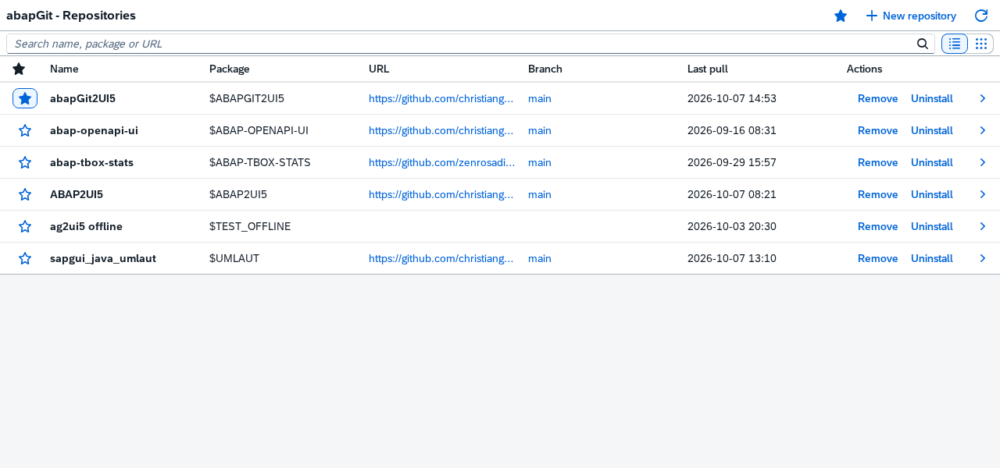
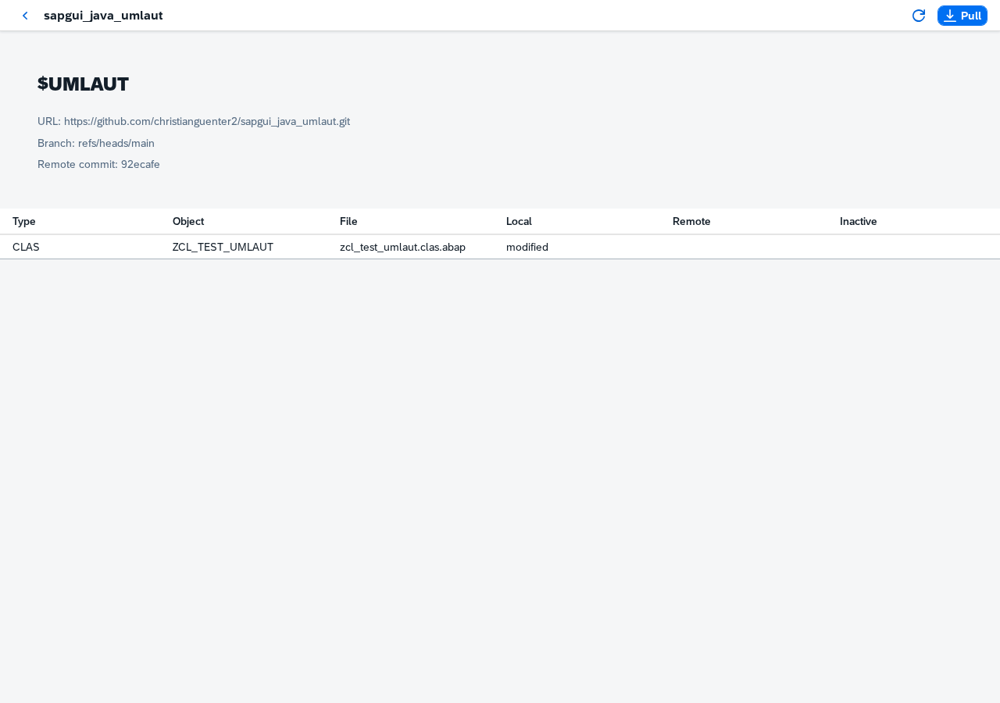
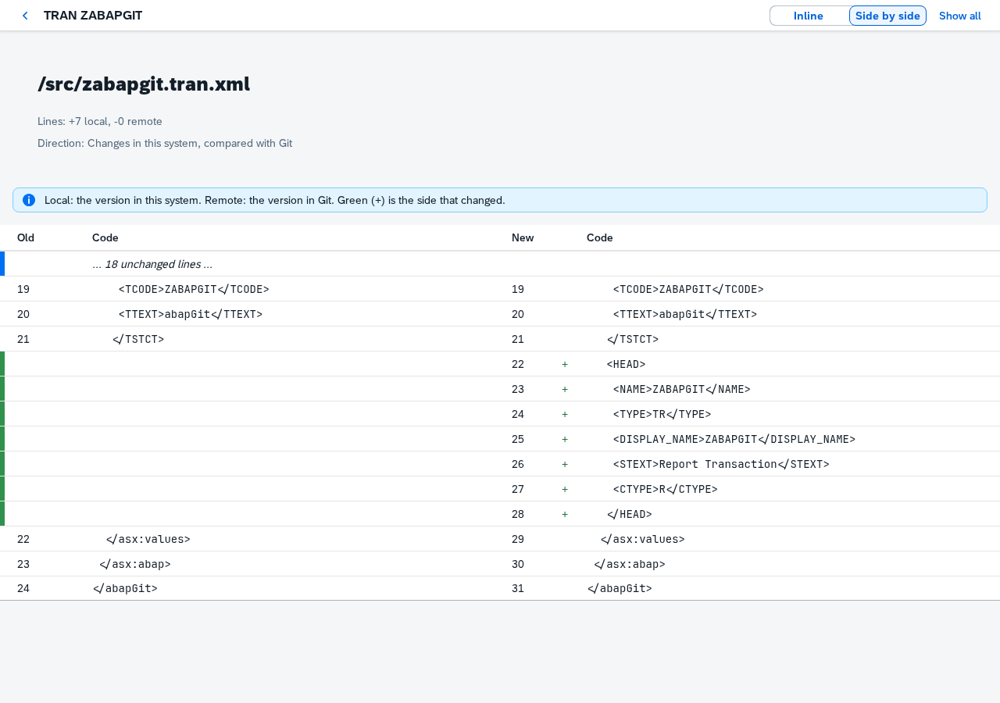
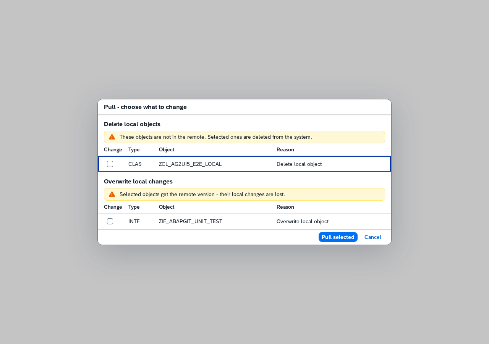
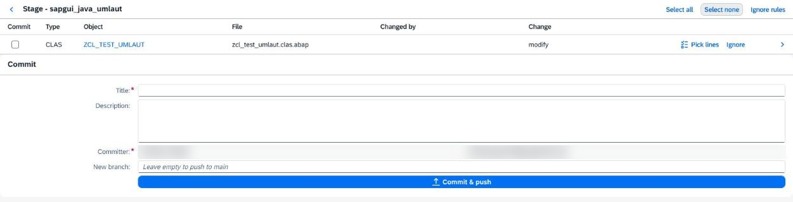

# abapGit2UI5

A browser frontend for [abapGit](https://github.com/abapGit/abapGit), built with
[abap2UI5](https://github.com/abap2UI5/abap2UI5). It runs in any browser, so
it avoids the quirks of the SAP GUI HTML control (IE and Edge controls, SAP GUI
for Java, WebGUI).

This is a proof of concept, tested end to end on an SAP NetWeaver 7.5x system
(A4H). It supports:

- **Repository list:** all abapGit repositories of the system, with a search,
  as a table or as tiles (one card per repository).
- **Remove / Uninstall:** available in both layouts, online and offline.
  Remove unregisters the repository and keeps its SAP objects. Uninstall
  previews the objects to delete, requires the package name to be typed, and
  asks for a workbench request when needed. The server checks the scope again
  and protects running code and other registered repositories. Partial failures
  retain registration and show the deletion log. SAP may retain packages until
  deletion transports are released. Neither action changes the remote Git repo.
- **New repository:** online (from a Git URL) or offline, with abapGit's
  settings and its own checks; each error is shown on its field. No
  credentials (a private repository needs abapGit's user exit).
  **Create package...** beside the package field creates a local or
  transportable package and returns its name to the form. Transportable
  packages need an existing workbench request; the server checks it again.
  Package creation is a separate step, so the package remains if repository
  creation later fails. An online repository may also bring its package along.
- **Offline repositories:** open an offline repository, import an abapGit or
  GitHub source ZIP through the same pull decision dialog, or export the
  current local files as a ZIP. Status and diff compare the uploaded ZIP
  with the system; branches and staging are available for online repositories.
- **Settings:** every toggle (list or tiles, the status page's overview, filter, sort
  and "changes on top", the diff's layout and "show all") is remembered per
  SAP user.
- **Status:** every file of the repository. Changed files (in the system, in
  Git or both, or inactive) are marked yellow, with a bar and a light
  background; the Local and Remote columns tell which side changed. "Changes
  only" hides the rest. Sort by object, file or type; "Changes on top" (on by
  default) lists the changed files first.
- **Object overview:** switch from Files to Objects for one row per ABAP
  object, with changed/total file counts and combined Local/Remote states.
  Press the row to see all its files and open a diff; Back returns to that
  file list. Files without an object appear under "Repository files".
- **Diff:** pressing a file in the status list shows its line diff, inline or
  side by side, with changes in context or the whole file. As in abapGit, the
  side that changed is the "new" one, in green. Side by side keeps the system
  left and Git right in both directions, as abapGit does. Added lines have a light green
  background, removed ones light red, folded unchanged lines light grey.
- **Stage, commit, push:** select the locally changed files, enter a commit
  message, then push with a Git user and token. The credentials are used for
  that one push only and never stored. "Pick lines" commits only some changes
  of a file: both halves of a changed line go together, as in abapGit.
- **Ignore:** staging respects abapGit's ignore rules and starting folder.
  A file's Ignore button opens its full path as an editable rule; use `*`
  for any sequence or `+` for one character. Preview the affected staging
  files, then save locally. **Ignore rules** lists existing rules and lets
  you preview/remove them. Commit `.abapgit.xml` to share the change.
  These are abapGit's native rules, not a conventional `.gitignore` file.
  Ignoring a tracked file leaves its remote version in place. Saving a rule
  reloads staging and clears file selections and picked lines; commit text
  and committer details stay.
- **Branches:** on the status page, switch to another branch of the remote
  (only the branch the repository follows changes; the status then shows what
  a pull would bring), create a branch at the current head ("New branch..."),
  or delete one after a confirmation. The default branch and the one the
  repository follows cannot be deleted. abapGit's exit supplies the
  credentials.
- **Pull with decisions:** a dialog lists every change, grouped by risk, with
  abapGit's defaults preselected. Only what you tick is changed. For
  transportable packages it asks for one of your modifiable transport
  requests. Mark all and Unmark all apply across the change groups to enabled
  rows; transport choices and the Pull anyway acknowledgment stay separate.

Not part of it yet: conventional `.gitignore` interpretation,
pushing to another branch, and creating a transport request from the dialog.

Object names in status, staging and pull decisions link to the local object
in Eclipse/ADT. The diff page offers the same link. Objects that are missing
locally or cannot be resolved stay as plain text. Enable the `adt` link
handler in Eclipse under **General > Link Handlers** to open these links.

| Repositories | Status | Diff |
|---|---|---|
|  |  |  |

| Pull | Stage |
|---|---|
|  |  |

The screenshots are rendered with `abap2ui5lint --screenshot`, using data from
a real system.

## Prerequisites

- The abapGit **developer version**, meaning the `ZCL_ABAPGIT_*` classes. The
  standalone program `ZABAPGIT_STANDALONE` is not enough, because its classes
  are local to the program.
- abap2UI5 1.146.0 or later, with its ICF service active.
- ABAP 7.50 or later.

## Installation

Install this repository with abapGit into a local package, for example
`$ABAPGIT2UI5`.

## Start

```
https://<host>:<port>/sap/bc/z2ui5?sap-client=<client>&app_start=zcl_ag2ui5_app_repos
```

## How a pull decides

Pull opens one dialog instead of abapGit's sequence of popups. Every object
appears once, in its most dangerous group:

| Group | Changes | Preselected |
|---|---|---|
| Data loss | Data would be lost, or a table with data would be deleted | no |
| Delete local objects | Objects that are not in the remote | no |
| Overwrite local changes | Objects changed in the system | no |
| Package change | Package moves, and objects in another package | no |
| Import | Added or changed only remotely, or deleted locally | yes (with a new namespace, only the namespace, as in abapGit) |
| Skipped | Object types abapGit does not support | cannot be selected |

"Pull selected" checks again before it imports. If the remote changed in
between, it imports nothing and asks you to review again. If requirements or
APACK dependencies are not met, you have to confirm "Pull anyway".

For transportable packages, the dialog asks for a transport request. It offers
your own modifiable requests of the required type (workbench or customizing),
and the server checks the choice again. Create the request in SE09 first;
creating one from the dialog is not supported yet.

Pulling a repository whose package contains abapGit, abap2UI5 or this
frontend is refused. It would replace code that is running in the same
session. Use abapGit in SAP GUI for those.

Using the frontend requires abapGit's startup authorization (see
`ZCL_ABAPGIT_AUTH_EXIT`). Private repositories are not supported, because there
is no way to enter credentials.

## Development

```sh
npm install
npm run check   # abaplint + abap2UI5 linter, no SAP system needed
```

Unit tests (`ZCL_AG2UI5_REPO_SERVICE`) run as ABAP Unit on the system.

For an offline repository, choose **Import ZIP**, select the file, and press
**Upload**. Review the decisions and choose **Pull selected** to import.
Canceling the decisions keeps the ZIP available for status and diff; Back
discards it, and reopening the repository starts without a ZIP. **Export
ZIP** downloads the local package as `repository.zip` (the button may be in
the header's overflow menu).

The design is in `docs/superpowers/specs/`. The results of the end-to-end test
are in `docs/findings.md`.
