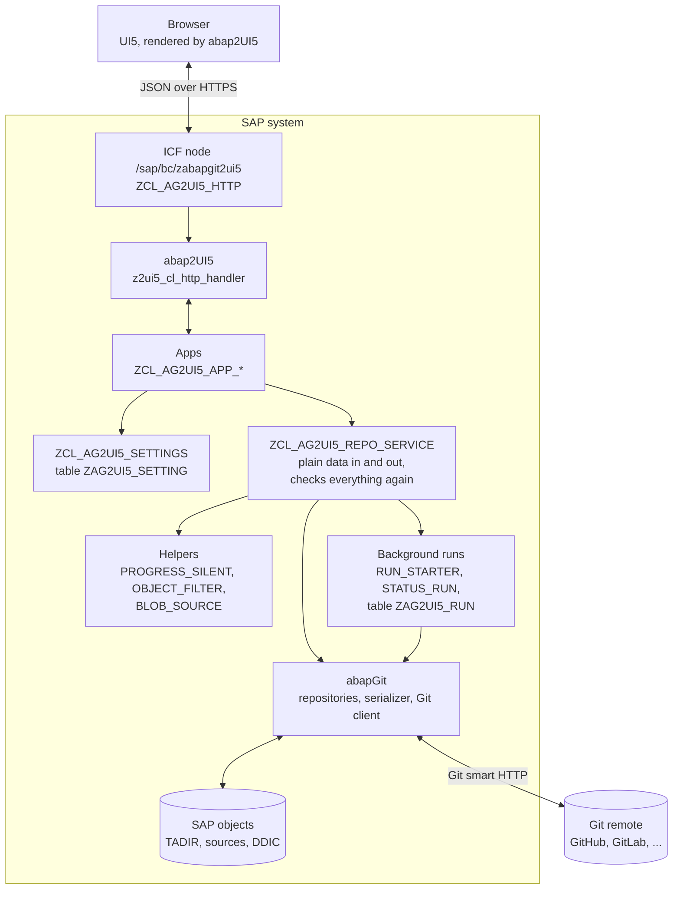
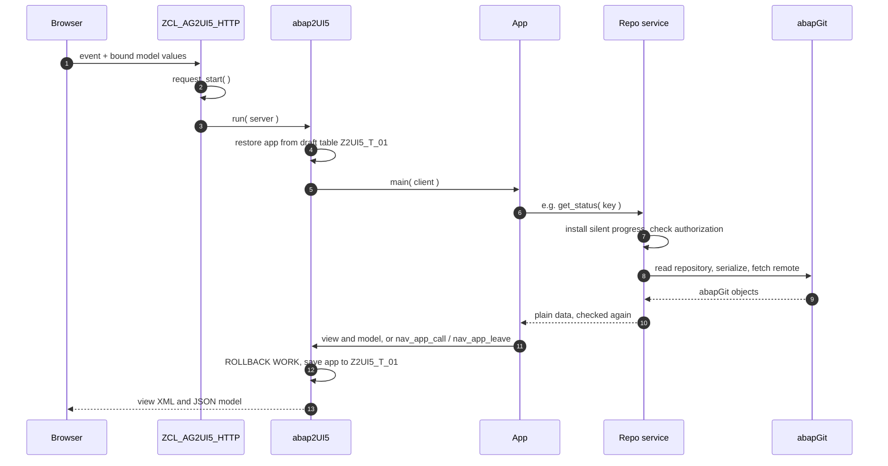
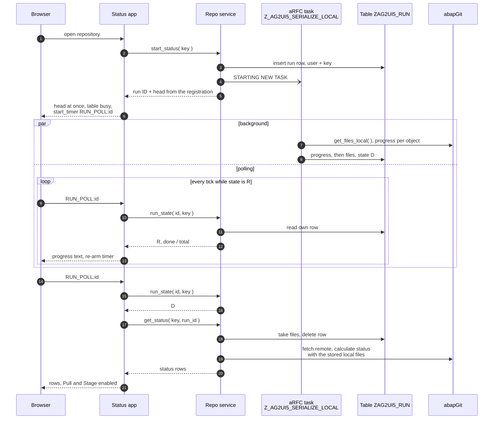
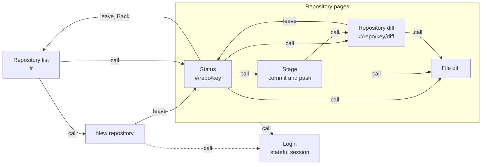

# Architecture

Four views of how abapGit2UI5 fits together. The rules behind them are in
[AGENTS.md](../AGENTS.md) ("Design rules").

## Components

Only the repository service talks to abapGit. The apps get plain data from it
and never keep an abapGit object: abap2UI5 serializes every attribute of an
app on each round trip.

`ZCL_AG2UI5_HTTP` resets abapGit's repository service once per request and
marks requests on its own node, which the login needs. abapGit2UI5 also runs
under abap2UI5's standard node `/sap/bc/z2ui5`, without login.

## One round trip

Every click that needs the server is one stateless request. The app is
restored from abap2UI5's draft table, handles the event, and is saved again.

Consequences:

- Writes that must stay commit themselves (`push`, settings, ignore rules),
  because abap2UI5 rolls back after `main( )`.
- The draft table holds every attribute as plain-text XML, so the login app
  clears its token in `main( )` before the save.
- Public attributes go to the browser. Only bound data is public; anything
  the browser sends is checked on the server against fresh abapGit data.

## Background Status run

Serializing the local objects is the slow part of a status. Status therefore
starts it in an aRFC task and polls. The task only serializes: no Git access
and no credentials, since the login lives in the HTTP session.

- The run ID stays in a PROTECTED attribute. Rows are read, updated and
  deleted only for `sy-uname` and the repository key.
- abap2UI5 cancels the timer on every round trip, so Status re-arms it at the
  end of each round trip that stays on the page.
- States other than `R` and `D`: `E` (error) and `G` (gone) end the poll with
  a message. So does a run without progress for 15 minutes. If no task can
  be started, Status loads synchronously.
- Only Status uses runs. Pull, push, previews and Stage load fresh and
  synchronously.

## App navigation

`nav_app_call` opens a page on top (Back returns), `nav_app_leave` replaces
the current one. List, Status and repository Diff have their own URLs.

Dashed: New repository and every repository page open Login when abapGit asks for credentials. It returns
with `LOGGED_IN:<host>`, and the app reloads what failed to load; actions are
not replayed. Stage returns `PUSHED` or `PUSHED:<message>` to Status, which
reloads. The list shows messages handed over with `nav_app_leave( r_data )`.
