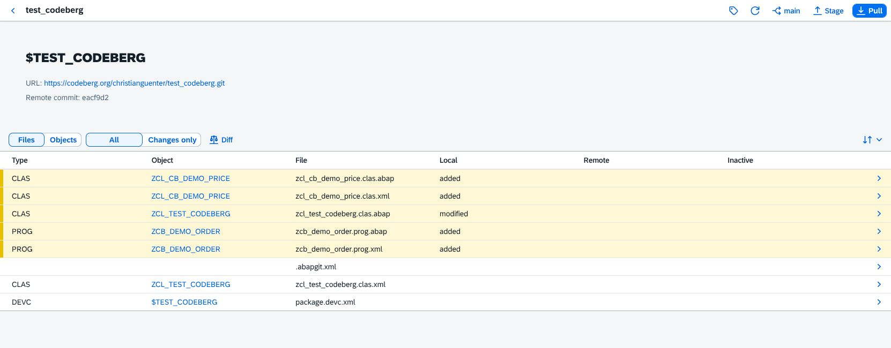
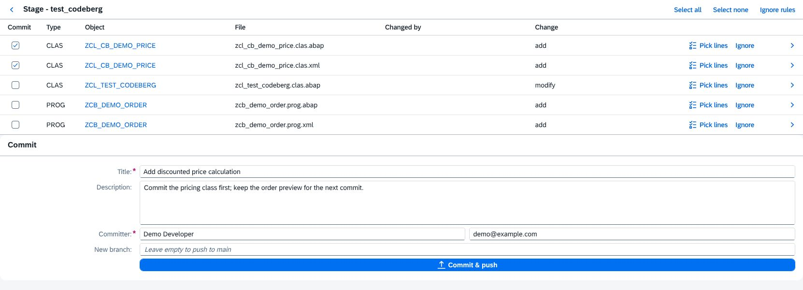

# From local changes to a focused commit

This example uses `test_codeberg`: one changed class, a new pricing class,
and a new order-preview report. Screenshots come from the running app.

## 1. Open the repository

Start on **Repositories** and search for `test_codeberg`. Choose **List** or
**Tiles**: in List, open the repository's row; in Tiles, click its header
(the name and package). Both open Status.

## 2. Find the changes

Status shows **added** and **modified** files in the Local column; the Remote
column shows changes in Git. Switch to **Changes
only** to focus on the work, or **Objects** to group the source and metadata.
Object links open in ADT.

## 3. Review what changed

Choose **Diff** to review all changed files, then **Open** on a file for its
detailed diff. **Side by side** compares the system with Git. For classes,
**Structural changes** lists added, removed and changed methods; choose an
entry to jump to its source range.

Here, `GREETING` and `ORDER_TOTAL` were added and `TEST` was changed. The raw
diff also shows formatting changes, which the method summary leaves out.

## 4. Commit one piece at a time

Back on Status, choose **Stage**. Select the pricing class's source and XML
metadata, leaving the other changes for later. **Pick lines** lets you select
parts of a file instead. Enter a title and your committer details; optionally
enter a new branch name.

**Commit & push** publishes the selection. When changes remain, Stage stays
open so you can prepare the next commit. The screenshot shows a prepared
draft with a fictional committer; this walkthrough stops before pushing.

